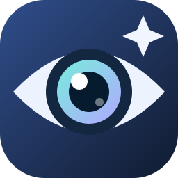
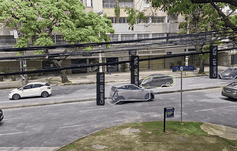
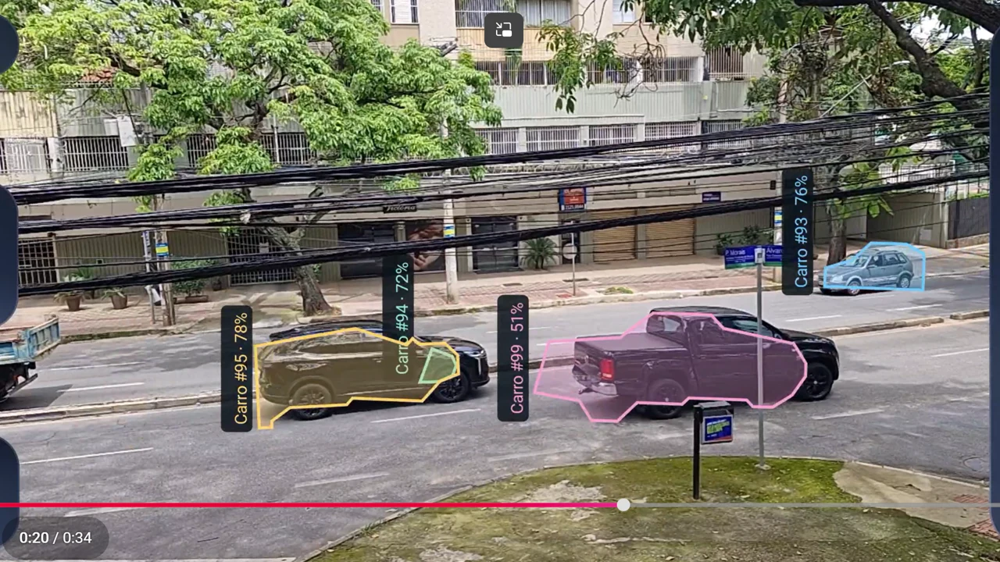
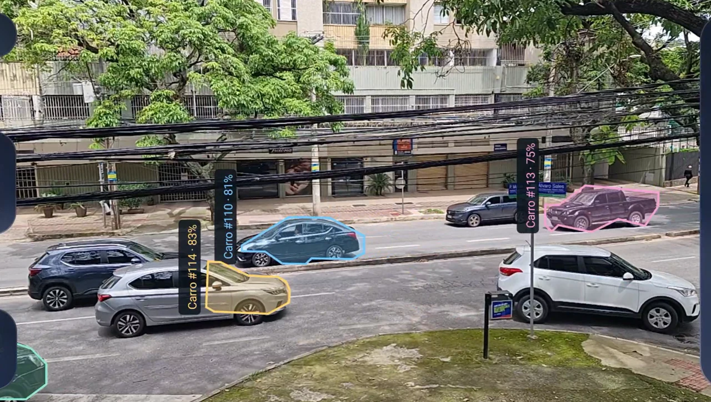
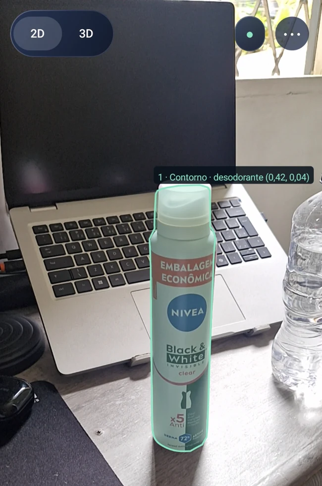
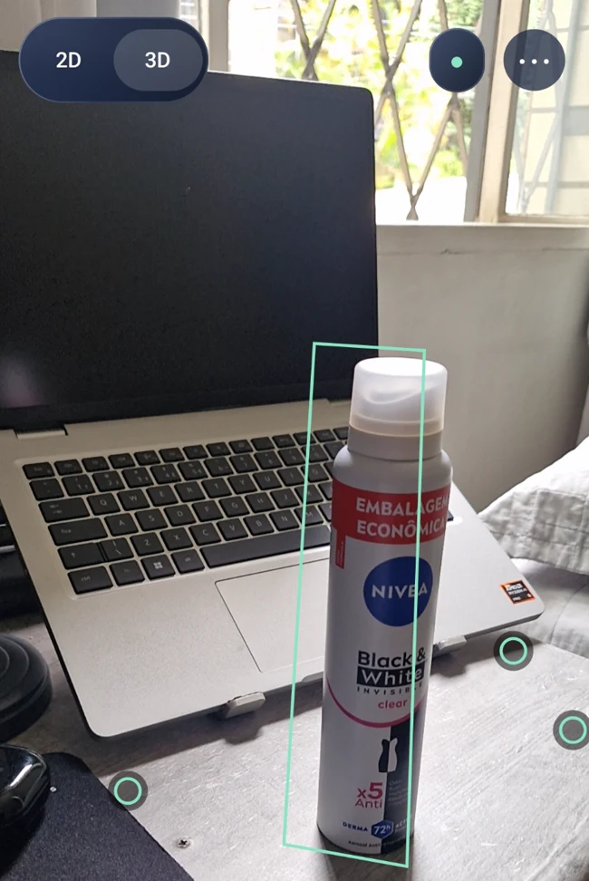
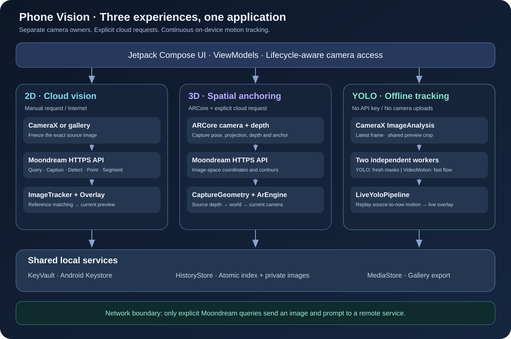
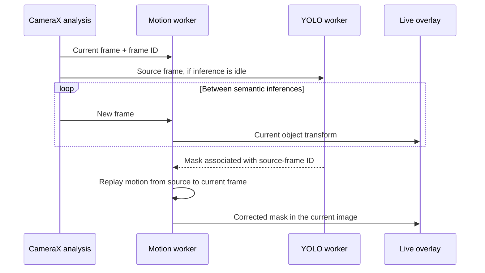

<div align="center">
  
  <h1>Phone Vision</h1>
  <p><strong>Ask about what you see. Anchor it in space. Track it in motion.</strong></p>
  <p>Android visual intelligence with Moondream, ARCore, and offline YOLO segmentation.</p>
  <p>
    <a href="https://github.com/t4rcisio/phone-vision/releases/latest"></a>
    <a href="https://github.com/t4rcisio/phone-vision/actions/workflows/ci.yml"></a>
    
    
    <a href="LICENSE"></a>
  </p>
  <p>
    <a href="https://github.com/t4rcisio/phone-vision/releases/latest"><strong>Download APK</strong></a> ·
    <a href="#see-it-in-action">Demos</a> ·
    <a href="#architecture">Architecture</a> ·
    <a href="#getting-started">Getting started</a> ·
    <a href="SECURITY.md">Privacy &amp; security</a> ·
    <a href="https://www.linkedin.com/in/t4rcisio/">LinkedIn</a>
  </p>
</div>

---

Phone Vision brings three complementary computer-vision experiences to one native Android app: explicit visual queries through **Moondream**, spatial annotations through **ARCore**, and continuous, **on-device YOLO segmentation and tracking**. Each experience has a separate camera owner and processing pipeline.

## See it in action

[](docs/assets/tracking-demo.mp4)

**Recorded in the app:** multiple vehicle masks and temporal tracking IDs. [Watch the full 34-second video](docs/assets/tracking-demo.mp4) · [Download the MP4](https://github.com/t4rcisio/phone-vision/releases/download/v1.3.0/tracking-demo.mp4)

<table>
  <tr>
    <td align="center" width="50%"><br /><strong>On-device instance segmentation</strong></td>
    <td align="center" width="50%"><br /><strong>Multiple moving objects</strong></td>
  </tr>
  <tr>
    <td align="center"><br /><strong>2D visual queries</strong></td>
    <td align="center"><br /><strong>Spatial annotations with ARCore</strong></td>
  </tr>
</table>

<sub>These supplied captures show an earlier Portuguese-language build. The current public app and documentation are English. Showcase files are cropped, stripped of capture metadata, and the recording is muted.</sub>

## Three modes, distinct capabilities

| Experience | What it does | Where it runs |
| --- | --- | --- |
| **2D camera** | Ask questions, describe images, locate objects, count points, extract text, and draw masks | Moondream for explicit queries; local feature matching for alignment |
| **3D camera** | Place environmental anchors and reproject image results as the device moves in XYZ and rotation | ARCore on the device; explicit Moondream queries when requested |
| **Track objects** | Continuously detect, segment, and follow moving objects from selected categories | Entirely on the device with YOLO, LiteRT, and optical flow |

### Visual queries

- **Ask:** natural-language questions about a captured image.
- **Describe:** automatic scene descriptions.
- **Detect:** object bounding boxes.
- **Point / count:** points for object occurrences.
- **Segment:** actual instance contours, not a rectangle substituted for a missing mask.
- **Read text:** transcription with optional instructions.
- Camera capture or gallery input in 2D, with single- or multiple-object spatial results.
- The live camera remains visible; **Results** opens the captured image and answer.

Only an explicit query sends an image and prompt to Moondream. Multiple-object segmentation can use two remote calls: detection followed by segmentation.

### Spatial anchors

Create anchors at the center or by touch, select and remove individual points, undo a point, clear annotations, or restart mapping. ARCore accounts for translation and rotation of the device.

Capture-time pose, projection, depth, and an anchor reference are preserved before a remote query. Returned contours are reconstructed in that original reference and projected through the current camera. Missing depth leaves the photo result available rather than inventing an apparently precise 3D overlay.

**An environmental anchor does not follow a moving vehicle.** Use Track objects for objects that move independently of the scene.

### Offline segmentation and tracking

- Bundled **YOLO26n-seg w8a32**, recognizing the 80 COCO categories.
- Select several categories together, such as **Car + Motorcycle**, and restore that choice after reopening.
- Adjustable confidence threshold, automatic image orientation, and manual 90-degree rotation.
- Temporal object IDs, pause/resume controls, and explicit snapshot saving.
- GPU inference when supported, with a CPU fallback.
- A separate optical-flow worker updates contours between semantic inferences.
- A short frame history compensates for object movement during the inference itself.

The model is included in the APK, so local tracking works offline from the first launch and needs no Moondream key. Its category list is fixed; open-ended descriptions and questions belong to the remote query experience.

### History and gallery

Remote query results automatically save the original image, annotated image, request type, prompt, response, coordinates, and timestamp. Tracking snapshots are saved only when **Save** is selected.

History persists in private app storage. Annotated images also export to **Pictures/Vision** through MediaStore. Updating the app while preserving its data keeps history and settings; uninstalling or clearing data removes private records. Gallery copies are separate files.

The UI prioritizes the camera with floating controls, glass panels, readable light text, and an adaptive app icon. The screen stays awake while the app is visible.

## Architecture



**The key design decision:** identifying an object and keeping an annotation aligned are separate jobs. A slow semantic inference should not determine the update rate of the visual tracker.



See the [architecture guide](docs/ARCHITECTURE.md) for component responsibilities, cloud request sequences, coordinate spaces, concurrency, frame ownership, and persistence.

## Getting started

### Install

Download the signed **ARM64 APK** from [GitHub Releases](https://github.com/t4rcisio/phone-vision/releases/latest) and install it on an Android 9+ device. Android may ask you to allow installation from the app used to open the APK.

The 2D camera and local tracking do not require ARCore. The 3D experience requires an ARCore-compatible device; depth-based contour reconstruction additionally depends on depth availability.

### Run offline tracking

1. Open **Menu → Track objects**.
2. Open the category selector, choose categories, and select **Apply**.
3. Point the camera at the scene and allow the initial model load to finish.
4. Use **Pause**, **Resume**, and **Save** as needed.

The upper menu exposes confidence, orientation, and processing diagnostics.

### Configure Moondream

1. Open **Menu → API** and save your own key and model choice.
2. Choose 2D or 3D and select the query action.
3. Enter an object or question where required, then select **Query**.
4. Open **Results** or **History** to review the saved output.

The key is entered at runtime, encrypted with Android Keystore, and never embedded in the APK. Remote queries require internet connectivity and access to the selected Moondream model.

## Performance and limitations

A reference live-camera measurement recorded approximately **19 tracking updates/s**, **4 ms** for optical-flow adjustment, and **155 ms** for YOLO inference. These are different processing stages, not a claim that segmentation itself runs at 19 FPS. The first model load can take several seconds.

Results depend on hardware, temperature, lighting, object count, and motion. Small or distant objects, blur, low texture, occlusion, and crossings can reduce tracking reliability or change IDs. IDs are temporal associations, not permanent identity recognition. The tracker transports the latest contour; the next inference refreshes its semantic shape.

2D matching is projective, not volumetric 3D. ARCore anchors refer to the environment, require a usable mapped scene, and belong to the current AR session.

## Build and test

**Requirements:** JDK 25, Android SDK 37 (`platforms;android-37.0`), and the checked-in Gradle wrapper. Configure `ANDROID_HOME` or use an untracked `local.properties` file generated by Android Studio.

```sh
git clone https://github.com/t4rcisio/phone-vision.git
cd phone-vision
./gradlew testDebugUnitTest lintDebug assembleDebug assembleDebugAndroidTest
```

On Windows, use `gradlew.bat`. To build only for an ARM64 device:

```sh
./gradlew -PvisionAbi=arm64-v8a assembleDebug
```

The debug APK is generated at `app/build/outputs/apk/debug/app-debug.apk`. Production signing is configured entirely through environment variables; see [Releasing](docs/RELEASING.md).

The test suite covers geometry, capture-time reprojection, public-image segmentation, moving foreground objects over a fixed background, delayed inference compensation, preview alignment, category selection, contrast, percent-label rendering, and persistence. Camera/AR tests require suitable hardware, and real API tests are opt-in. See [Contributing](CONTRIBUTING.md) for device-test precautions and fixture requirements.

## Technology

| Layer | Components |
| --- | --- |
| Android UI | Kotlin, Jetpack Compose, Material 3 |
| Camera | CameraX Preview + ImageAnalysis; ARCore for 3D |
| Remote vision | Moondream HTTPS API |
| Local vision | YOLO26n-seg, LiteRT, OpenCV |
| Geometry | ORB/RANSAC, Lucas–Kanade flow, depth reconstruction |
| Storage | Android Keystore, private files, AtomicFile, MediaStore |

## Privacy, contributions, and license

Read the [security and privacy model](SECURITY.md) before using remote queries with sensitive images. YOLO processing is local; explicit Moondream queries send the actual image and prompt to that service.

Contributions are welcome through [issues](https://github.com/t4rcisio/phone-vision/issues) and pull requests. Please read [CONTRIBUTING.md](CONTRIBUTING.md).

The project is released under [AGPL-3.0](LICENSE). Bundled model weights and third-party libraries retain their respective licenses; see [third-party notices](THIRD_PARTY_NOTICES.md) and [model provenance](app/src/main/assets/yolo-model.json).

---

<div align="center">
  Built by <a href="https://github.com/t4rcisio">t4rcisio</a> · <a href="https://www.linkedin.com/in/t4rcisio/">Connect on LinkedIn</a>
</div>
