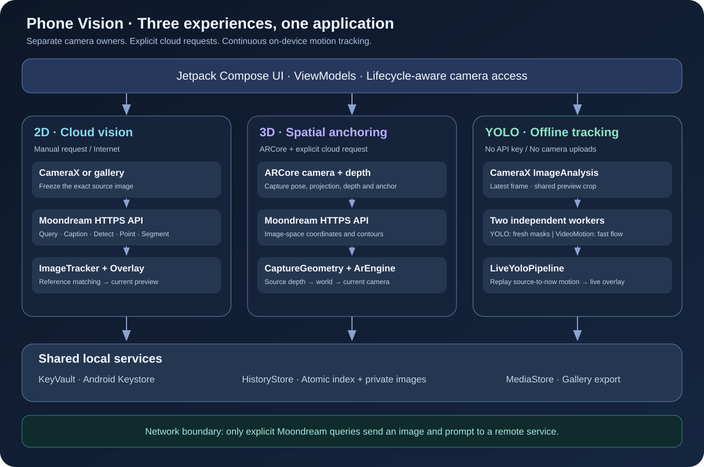
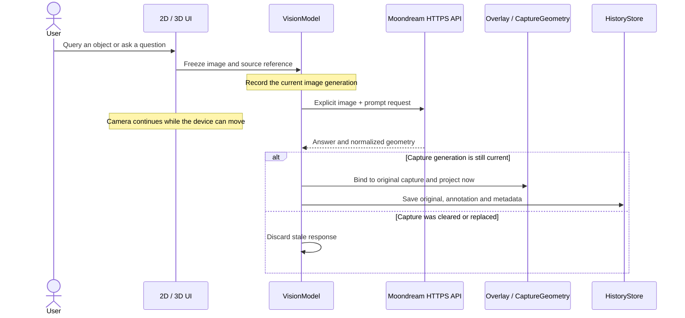
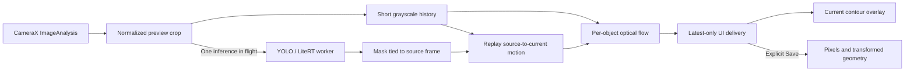

# Architecture

Phone Vision provides three camera experiences with different responsibilities. The 2D and 3D experiences use Moondream only when the user explicitly requests a query. The tracking experience runs YOLO and motion estimation on the device.

## 1. Components and boundaries

| Component | Responsibility |
| --- | --- |
| `MainActivity`, `CameraScene`, `CameraUi` | 2D camera/gallery, query controls, overlays, and manual points |
| `VisionModel` | Immutable query capture, response generation checks, persistence, settings |
| `Moondream` | HTTPS request construction and normalized response validation |
| `ArActivity`, `ArEngine` | Exclusive ARCore camera ownership, session lifecycle, anchors, rendering |
| `DepthSnapshot`, `CaptureGeometry`, `ArMath` | Capture-time depth and coordinate reconstruction |
| `ObjectTrackingActivity`, `ObjectTrackingModel` | Independent local tracking UI, categories, confidence, snapshots |
| `TrackingCameraFeed` | CameraX Preview and ImageAnalysis with a shared ViewPort |
| `LiveYoloPipeline` | Independent inference and motion workers, generation/epoch checks, latest-only delivery |
| `YoloSegmenter`, `YoloDecode` | RGB preprocessing, LiteRT execution, class-aware NMS, instance masks |
| `YoloOrientation`, `YoloTrackIds` | Upright inference, inverse coordinate mapping, temporal IDs |
| `VideoMotion` | Source-frame replay and per-object optical-flow updates between inferences |
| `KeyVault`, `HistoryStore` | Encrypted credentials, atomic history index, images, gallery publication |

Sources are under [`app/src/main/java/com/example/vision`](../app/src/main/java/com/example/vision). Framework objects stay with their camera owner; switching experiences must not create competing camera sessions.

## 2. Remote query lifecycle

In 2D, ORB feature matching and RANSAC compare the original image directly with the live scene. This is a projective approximation, not a volumetric reconstruction.

In 3D, the capture preserves the camera projection, pose, display/depth mapping, timestamp, and an immutable depth snapshot. A capture reference anchor is created before the network request. Returned contour vertices are reconstructed from the original depth and rendered through the current camera pose. They must never be hit-tested against a different, later frame.

Without a valid depth/pose reference, the photo result remains available but an apparently precise 3D contour is not invented. Manual anchors use valid ARCore surface/depth hit tests. They refer to the environment, not to movable-object identities.

## 3. Local inference and fast motion updates

The camera provides CPU-accessible frames instead of repeatedly reading the full-resolution preview back from the GPU. Preview and analysis share a CameraX ViewPort; crop and camera rotation are applied before inference or motion processing.

The YOLO worker remains on one OS thread for GPU context affinity. It computes fresh instance masks. A separate camera-analysis worker follows object features with pyramidal Lucas–Kanade flow, forward/backward checks, photometric error filtering, and robust affine fitting.

When an inference finishes, the source-frame ID selects the matching history entry. Feature motion is replayed through intervening frames before the new mask is displayed. The history is bounded to 28 grayscale frames and approximately one second; a result whose source has expired is rejected instead of drawing old geometry.

The fast tracker transports the latest semantic contour. It does not rerun segmentation or infer a newly exposed surface on every camera frame. The next YOLO result refreshes that shape. Insufficient features, blur, occlusion, or implausible motion can hide an overlay until a reliable result returns.

## 4. Coordinate spaces

| Space | Convention | Conversion |
| --- | --- | --- |
| Image / preview | Normalized X/Y, top-left origin | Scale only when drawing into the viewport |
| Segmentation path | Normalized inside its bounding box | Apply box scale/translation before preview projection |
| YOLO tensor | RGB NCHW, 640 × 640 | Letterbox and remove padding on the return path |
| Rotated inference | Upright image orientation | Inverse-map the box and every path vertex into preview coordinates |
| AR world | ARCore pose/depth reference | Capture-time reconstruction, then current-camera projection |
| Motion history | Image pixels with frame IDs | Fit normalized source-to-current affine transforms |

These spaces must not be mixed: updating a box origin without updating its vertices distorts a contour, and applying current depth to an old image shifts an AR result.

## 5. Ownership and lifecycle

- `VideoFrame` uses reference counting because camera analysis, inference, and UI delivery can hold the same immutable bitmap concurrently.
- UI delivery keeps only the newest output, avoiding an increasing queue of old frames.
- Configuration generations invalidate results after clearing, category changes, confidence changes, rotation changes, or pausing.
- Session epochs invalidate camera work across lifecycle transitions.
- Camera owners and GPU resources are released through lifecycle/disposal hooks. GPU disposal runs on the GPU worker thread.
- Detailed exception logs are debug-only; the application never logs the API key or request body.

## 6. Storage

`KeyVault` stores AES-GCM ciphertext and its IV in private preferences; its encryption key stays in Android Keystore. `HistoryStore` serializes concurrent writers through a shared mutex and replaces its JSON index with `AtomicFile`.

Cloud query history is saved automatically after a successful query. Local tracking history is saved only when the user selects Save. Gallery output is a separate MediaStore transaction. A gallery failure does not discard a valid private history entry.

For a tracking snapshot, the current motion transform is baked into the bounding box and every contour vertex before pixels and annotations are saved together.
